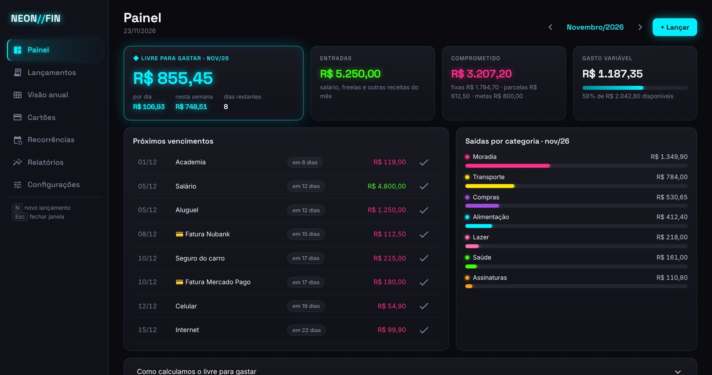
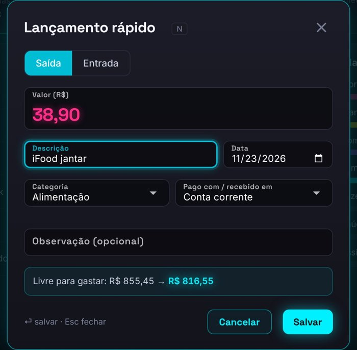
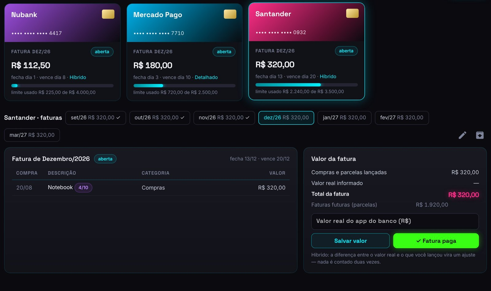
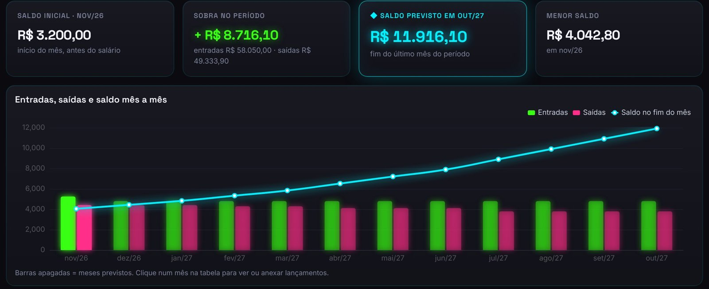
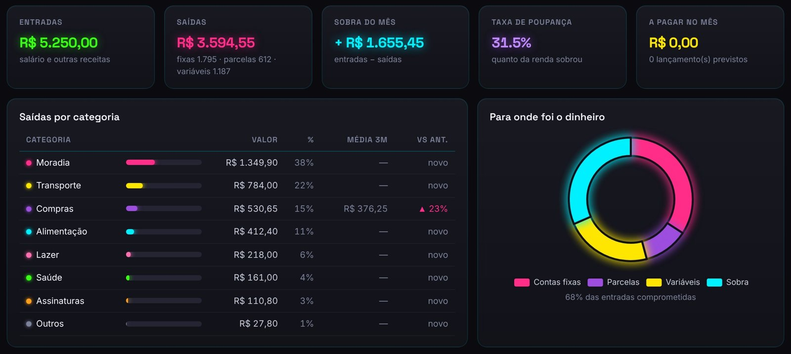

# NEON//FIN

**Controle financeiro pessoal com foco em previsibilidade.**
Um app em Python que abre no navegador e responde, a qualquer momento:
**quanto eu ainda posso gastar hoje, nesta semana e neste mês?**, já descontando contas fixas, parcelas de cartão e reservas.

> ⚠️ Todas as telas abaixo usam **dados fictícios** (`python main.py --exemplo`).



---

## Funcionalidades

| | |
|---|---|
| **Painel** | Livre para gastar no mês, na semana e no dia · alerta de ritmo de gastos · próximos vencimentos com "marcar como pago" · saídas por categoria · cálculo explicado passo a passo |
| **Lançamento rápido** | Tecla **N** abre, **Enter** salva · categoria sugerida pela descrição · prévia do impacto no "livre para gastar" |
| **Cartões** | Quantos quiser, cada um com fechamento, vencimento e limite · parcelamento até 48x · 3 modos de fatura (detalhado, simples, híbrido) sem contar nada duas vezes |
| **Recorrências** | Contas fixas e receitas geram 12 meses de previstos · reajuste com escopo (só este mês / daqui em diante / todos) |
| **Visão anual** | Saldo previsto mês a mês · estimativa de gastos variáveis editável por mês · gastos planejados (IPVA, viagem...) |
| **Relatórios** | Mensal e por período · categorias vs. média de 3 meses · top 10 gastos · por cartão e dia da semana · exportação para Excel |
| **Filtro de meses** | Período De/Até (até 36 meses), atalhos e escolha mês a mês |

<p>
  
  
</p>




---

## Stack e decisões técnicas

- **Python 3.11+** de ponta a ponta, com **[NiceGUI](https://nicegui.io)** (FastAPI + Vue/Quasar) na interface web
- **SQLite + SQLModel** (SQLAlchemy), modo WAL, com **backup automático** a cada abertura (mantém os 30 últimos)
- **Tabela fato única de lançamentos**: contas fixas, parcelas, totais e ajustes de fatura geram linhas nela, então relatórios e projeção leem uma fonte só
- **Valores em centavos (inteiro)**: zero erro de arredondamento de ponto flutuante
- **Cartão no mês da fatura**: compras e parcelas no cartão contam no mês em que a fatura vence, que é quando o dinheiro sai da conta
- **Regras de negócio em funções puras** (`app/servicos/`), separadas da interface e cobertas por **54 testes com pytest**
- **Geração idempotente** de previstos (restrições únicas no banco impedem duplicar)
- **ECharts** para os gráficos e um design system escuro/neon próprio (Space Grotesk + Inter)
- **openpyxl** para exportação em Excel

### Regras principais

- Compra no cartão **no dia do fechamento ou depois** vai para a fatura seguinte.
- `Livre (mês) = entradas − fixas − parcelas − reserva para metas − gastos variáveis`
- `Livre (dia) = livre do mês ÷ dias restantes (inclui hoje)`, arredondado para baixo.
- Projeção futura de gastos variáveis = `max(lançado, estimativa) + planejados`.
- Lançamentos já pagos nunca são alterados por reajuste de recorrência.

---

## Como rodar

```bash
git clone <url-do-repositorio>
cd neon_fin
python -m venv .venv
# Windows: .venv\Scripts\activate   |   Linux/Mac: source .venv/bin/activate
pip install -r requirements.txt

python main.py                 # seus dados (dados/financas.db), abre em http://localhost:8080
python main.py --exemplo       # dados fictícios (dados/exemplo.db)
python main.py --porta 8090    # outra porta
python -m pytest -q            # testes
```

No Windows também dá para usar `rodar.bat` (cria o ambiente na primeira vez) e `testar.bat`.

Os dados ficam em `dados/`, que está no `.gitignore`: **nenhuma informação financeira sua vai para o repositório**.

---

## Estrutura

```
main.py                 inicia, faz backup, gera previstos e abre o navegador
app/
  dados/                modelos (tabelas) e conexão com o banco
  servicos/             regras de negócio: livre.py, cartoes.py, lancamentos.py,
                        recorrencias.py, projecao.py, relatorios.py
  ui/                   tema.css, componentes e telas (NiceGUI)
  exemplo.py            dados fictícios para demonstração
tests/                  testes automatizados (pytest)
static/fonts/           Space Grotesk e Inter (SIL Open Font License)
docs/img/               capturas de tela (dados fictícios)
```

---

## Roadmap

- [ ] Orçamento por envelopes com alertas de 80% / 100%
- [ ] Metas com prazo e reserva de emergência
- [ ] Calendário de vencimentos
- [ ] Simulador "e se?" (compra parcelada, aumento de renda)
- [ ] Indicador de saúde financeira

---

Desenvolvido com o apoio de IA (Claude): especificação, regras de negócio e validação por **Leonardo**.
